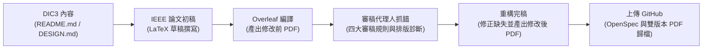

# DIC4 系統設計與審稿架構 (Design Specification)

## 1. 端到端論文轉譯與審稿重構工作流程

本流程描述如何將 DIC3 專案規格轉換為 IEEE 會議論文，並透過 Overleaf 編譯與審稿代理人回饋進行閉環重構，最終歸檔上傳至 GitHub：

---

## 2. 四大核心審稿規則 (Four Core Review Rules)

論文審稿代理人（Paper Reviewer Agent）於審查初稿時，必須嚴格執行以下四大核心規則，任一項目未達標即判定為需重構項目：

### 規則一：摘要必須符合 A–F 六段式結構
摘要（Abstract）須完整涵蓋並清楚對應 A 至 F 六個邏輯段落，不可缺漏或順序錯置：
- **A (Attention Getter)**：點出 2025–2026 淨零碳排趨勢與台電新版尖離峰時間電價（TOU 價差達 3.5–4 倍）之迫切時代脈絡。
- **B (But)**：指出現有 EMS 語意鴻溝、通用 LLM 物理幻覺風險、以及強制需量控制犧牲舒適度三大痛點。
- **C (Cure)**：提出 WattWise AI 領域專用代理（Domain AI Agent）之創新解方。
- **D (Development)**：簡述八大解耦模組、受限白名單工具呼叫、信心度 `< 0.80` 主動澄清迴圈、MILP 排程與 `90%` 契約容量安全守門機制。
- **E (Experiments)**：說明採用公開基準資料集（REDD、UK-DALE、AMPds2）與校園/住宅實測場域之雙軌驗證規劃。
- **F (Findings / Expected Impact)**：總結預期達成之尖峰抑低效益（15–20%）、消除超約罰款與維持熱舒適度（PPD ≤ 15%）之實質影響。

### 規則二：緒論必須符合 G–L 六維展開結構
緒論（Introduction）須遵循 A2Z SOP Outline 的 G 至 L 架構層層推進：
- **G (General Context)**：說明全球建築能耗與台灣夜尖峰電價政策背景。
- **H (However Bottlenecks)**：剖析既有技術在語意斷層、知識匱乏與安全邊界缺位上的瓶頸。
- **I (In Literature & Method)**：定位現有文獻不足並切入「電力物理模型閉環注入」方法論。
- **J (Judgement)**：呈現系統定位與競爭力分析（對應 SWOT 剖析）。
- **K (Keypoint)**：明確條列核心研發目標與量化指標（FR-01 至 FR-05）。
- **L (List Organization)**：交代論文後續各章節之組織架構。

### 規則三：相關研究須維持「一半人工智慧技術 + 一半電力領域知識」
相關研究與文獻探討（Related Work）不可偏廢單一領域，必須嚴格維持 **50% 人工智慧技術** 與 **50% 電力工程領域知識** 之平衡比例：
- **AI 技術面（1/2）**：涵蓋多代理強化學習（PPO）、時序 Transformer、擴散模型（Diffusion Models）、物理資訊神經網路（PINN）、檢索增強生成（RAG）與 ReAct 推理框架。
- **電力領域知識面（1/2）**：涵蓋建築熱力學 2R2C 模型、台電/PJM 時間電價規則、家電啟動暫態 V-I 特徵與功率因數、ASHRAE 55 PMV/PPD 熱舒適度方程、契約容量與斷路器反時限安秒特性曲線。

### 規則四：嚴守不可虛構實驗數據規範
本專案目前處於提案與架構設計階段，論文中**嚴禁捏造、編造或填寫任何未經實測之假實驗數據**（例如虛構的執行後 MAPE 數值、實際省電百分比或偽造之對照實驗結果表）：
- 僅可陳述「評估方法論」、「基準資料集（REDD / UK-DALE / AMPds2）」、「量化指標公式定義（MAPE、RMSE、F1-Score、TDI、SIR）」、「消融實驗架構（Model A–D）」以及「基於文獻與電價規則推導之預期效益目標」。
- 任何尚未執行的實驗結果欄位須明確標示為「待實測驗證（Pending Evaluation）」或僅描述驗證計畫，絕不可偽裝成已完成的實測結果。

---

## 3. 技術設計決策 (Design Decisions)
- **文件語言與格式**：OpenSpec 規劃文件與審稿規則維持全繁體中文；IEEE 論文本文依會議格式規範撰寫（並確保專業術語與 DIC3 一致）。
- **安全與一致性校驗**：確保論文中之演算法虛擬碼、系統架構圖與流程圖皆統一採用「`90%` 契約容量臨界值」與「信心度 `< 0.80` 澄清迴圈」，與 `README.md` 及 `DESIGN.md` 完全對齊。

